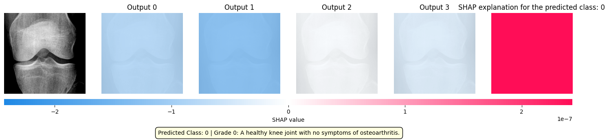
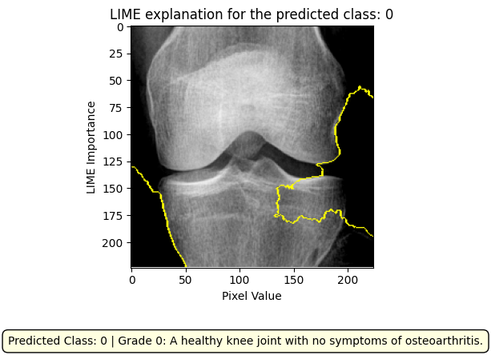

# Knee Osteoarthritis Detection and Severity Grading

[](https://github.com/fizaamjad897/Knee-Osteoarthritis-Grading/actions/workflows/ci.yml)
[](LICENSE)
[](docs/REPRODUCIBILITY.md)

Academic research on classifying knee X-rays into **Kellgren–Lawrence (KL) grades 0–4** with transfer learning and SHAP/LIME explanations. This repository contains the original Colab notebooks, image splits, saved figures, and maintenance tools for auditing data and evaluating exported predictions.

**Research use only. This is not a clinically validated diagnostic system.**

> **Evaluation limitation:** a content-hash audit found **2,834 byte-identical image pairs across the committed training and test splits** (2,834 of 2,889 test images). The saved notebook scores are historical observations, not independent-test benchmark claims. The notebook named ResNet50 also constructs InceptionResNetV2. See [dataset findings](docs/DATASET_CARD.md) and [known issues](docs/KNOWN_ISSUES.md) before interpreting any result.

## Live demo video

https://github.com/user-attachments/assets/6c8829a7-d591-4833-bad3-87e621091627

[Live demo video](https://knee-oa-grading.netlify.app/) · [Download the MP4](docs/media/knee-oa-reel.mp4) · [HTML source](docs/media/knee-oa-reel.html)

The video presents historical experiments and illustrative interface scenes; the evaluation limitations above still apply.

## Start here

- [Run the maintenance tools or prepare a research environment](docs/REPRODUCIBILITY.md)
- [Understand dataset counts, overlap, and provenance](docs/DATASET_CARD.md)
- [Read model scope and limitations](docs/MODEL_CARD.md)
- [Inspect the evaluation protocol and historical results](docs/BENCHMARKS.md)
- [Contribute](CONTRIBUTING.md), [get help](SUPPORT.md), or [report a security concern](SECURITY.md)

## Repository map

| Path | Purpose |
| --- | --- |
| `data_preparation.ipynb` | Sampling and augmentation experiments |
| `data_modeling_XceptionModel.ipynb` | Xception modeling notebook |
| `data_modeling_InceptionResNetV2.ipynb` | InceptionResNetV2 modeling notebook |
| `data_modeling_DenseNet201.ipynb` | DenseNet201 modeling notebook |
| `data_modeling_ResNet50.ipynb` | Historical notebook with an architecture/provenance mismatch |
| `Xception_Model_Test.ipynb` | Additional saved Xception evaluation; requires an absent checkpoint |
| [SHAP/LIME notebook](image_description_via_SHAP%20and%20LIME.ipynb) | Per-image explanation experiments |
| `dataset/` | Original training and test PNG splits |
| `media_files/` | Saved plots, explanation images, and a ResNet50 weights file |
| `scripts/` | Dataset audit, CSV evaluator, repository checks |
| `tests/` | Tests for the maintained tooling |
| `docs/` | Dataset/model cards, reproduction instructions, maintenance guidance |
| `benchmarks/legacy-results.json` | Machine-readable metrics transcribed from saved notebook output |

Original notebooks, datasets, archive, and paper remain in their original locations. They have not been regenerated by the maintenance checks.

## Quick start: audit and evaluate

Use Python **3.12 or newer**. No TensorFlow, GPU, or model checkpoint is needed for these tools.

```sh
git clone https://github.com/fizaamjad897/Knee-Osteoarthritis-Grading.git
cd Knee-Osteoarthritis-Grading
python -m venv .venv
source .venv/bin/activate
python -m pip install --require-hashes -r requirements-dev.lock.txt

python -m scripts.audit_dataset dataset --output reports/dataset-audit.json
python -m scripts.evaluate examples/predictions.csv \
  --model synthetic-example --split synthetic-example \
  --output reports/example-metrics.json
python -m scripts.check_repository
python -m pytest
ruff check scripts tests
ruff format --check scripts tests
```

On Windows, activate with `.venv\Scripts\Activate.ps1` in PowerShell. The CSV example is synthetic and demonstrates the interface; it is not a model result. Reports and local environments are ignored by Git.

To make overlap a failing condition, run `python -m scripts.audit_dataset dataset --strict`. It is **expected to fail for the current historical dataset**. The normal audit checks structure while reporting overlap explicitly. Neither mode establishes patient-level independence.

## Historical notebook output

These figures were saved before this maintenance pass, on a 2,750-image sampled evaluation set. They have **not** been reproduced in a fresh training run and must not be read as a validated leaderboard.

| Notebook label | Accuracy | Balanced accuracy | Interpretation |
| --- | ---: | ---: | --- |
| Xception | 86.62% | 90.17% | Historical sampled-validation output |
| InceptionResNetV2 | 78.58% | 84.33% | Historical sampled-validation output |
| DenseNet201 | 76.11% | 80.42% | Historical sampled-validation output |
| ResNet50 | 70.15% | 76.78% | Architecture mismatch; attribution unverified |

`Xception_Model_Test.ipynb` separately reports **83.71%** accuracy. It is a different saved run, not an interchangeable Xception result. See [metric provenance](docs/BENCHMARKS.md).

## Explainability assets

The following are existing notebook exports, not newly generated explanations. They illustrate model behavior; they do not establish causal or clinical correctness.

| SHAP example | LIME example |
| --- | --- |
|  |  |

## Reproducibility status

The original runtime was Google Colab (notebook metadata records Python 3.11.4 and a T4 GPU in some notebooks). The exact original dependency lock and sampled image manifests were not committed. Notebook code includes hardcoded `/content/` paths, unseeded sampling, missing variables, and an unavailable Xception checkpoint. The new tools are reproducible independently of that historical training state; the original training results are not yet fully reproducible. [Details and next steps](docs/REPRODUCIBILITY.md).

## License and citation

Your reuse of the original code and maintenance tooling is governed by [MIT](LICENSE). **This does not license the X-ray dataset, paper, pretrained weights, or third-party material.** Their provenance and redistribution permissions must be established separately; see [asset licensing](docs/ASSET_LICENSING.md).

Use [CITATION.cff](CITATION.cff) to cite the repository. Do not infer a paper DOI, publication venue, or clinical approval from this project.
